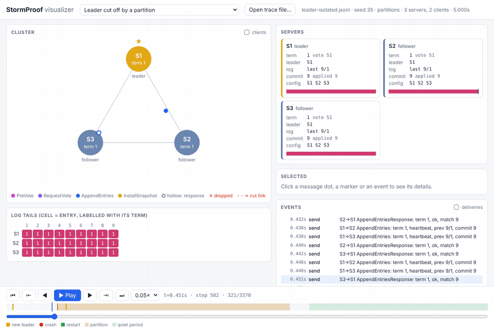
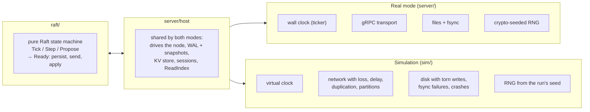
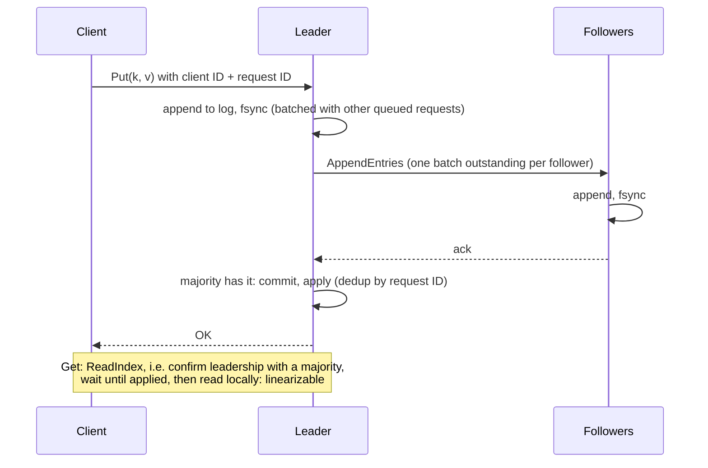

# StormProof

[](https://github.com/20001172024/StormProof/actions/workflows/ci.yml)
[](https://github.com/20001172024/StormProof/actions/workflows/nightly.yml)

A replicated key-value store on **Raft implemented from scratch**, tested by
a **deterministic simulator** that runs the whole cluster in one process
under crashes, partitions, message loss and disk faults, and replays any
failure exactly from its seed, with a **time-travel visualizer** to step
through what happened.

- **Linearizable**: every simulated run's client history is checked with
  [Porcupine](https://github.com/anishathalye/porcupine), on top of the
  Raft safety invariants checked after every step.
- **Tested at scale**: more than 3,000 simulated runs on every push, 50,000
  every night, under five fault profiles plus a harsher `storm` profile.
- **Found real bugs**: a Raft liveness bug under heavy faults (fixed with
  pre-vote), and a replication storm that made throughput *fall* as
  clients were added (fixed with flow control and batching).
- **Runs for real**: the same server code over gRPC, with a CLI,
  Prometheus metrics, docker-compose clusters, Kubernetes manifests and
  Terraform for AWS.



*The visualizer replaying a simulated run (partitions profile, seed 35):
the leader S1 is cut off; S3 runs a pre-vote round and wins term 2 while S1
still believes it leads term 1; after the heal, S1 steps down and catches
up. Red dashed arrows are cut links, dots are messages in flight.*

## How it works

The Raft node is a **pure state machine**: no goroutines, clocks, I/O or
randomness of its own. It only reacts to `Tick`, `Step` (a message) and
`Propose`, and hands back a `Ready` batch of work: state to persist,
messages to send, entries to apply. Everything around it, time, network,
disk and randomness, is an interface with two implementations.



In simulation, every node, the network, the disks and the clients run on
**one goroutine, driven by one seed**, so a run is a pure function of its
seed: replaying it gives a byte-identical trace (a test checks exactly
that). After every step the simulator checks election safety, log
matching, leader completeness and state machine safety; at the end it
checks that the cluster settled and that the client history is
linearizable. A failing seed is saved with its trace, which the visualizer
loads.

A client request in real mode:



More in [docs/design.md](docs/design.md): the determinism rules, each Raft
rule and where it is implemented, and what each milestone's simulator runs
showed.

## Try it

Requires Go 1.24+ (and Docker for the cluster).

```bash
go run ./sim/cmd/stormproof-sim -seeds 1000 -profile all             # 1,000 simulated runs, every fault profile
go run ./sim/cmd/stormproof-sim -seeds 20 -bug fsync -trace-dir t/   # plant a bug and watch it get caught
go run ./sim/cmd/stormproof-sim -seed 7 -bug fsync -trace s7.jsonl   # replay one seed, write its trace

docker compose -f deploy/docker/docker-compose.yml up -d --build --wait   # 3 servers + Prometheus
docker compose -f deploy/docker/docker-compose.yml run --rm cli put greeting hello
docker compose -f deploy/docker/docker-compose.yml run --rm cli get greeting
docker compose -f deploy/docker/docker-compose.yml down -v

cd visualizer && npm ci && npm run dev    # then drop a .jsonl trace on the page
```

The visualizer is also published at
**[20001172024.github.io/StormProof](https://20001172024.github.io/StormProof/)**,
preloaded with example traces: a leader crash, a leader cut off by a partition, an isolated
follower with and without pre-vote, membership changes, and a planted bug
caught by an invariant.

## What testing found

**By the simulator** ([docs/bugs/](docs/bugs/), each with its seed,
symptom, root cause, fix and commit):

| # | Where | What |
|---|---|---|
| [005](docs/bugs/005-disruptive-candidate-liveness.md) | Raft (liveness) | Under heavy faults, a server whose log was behind kept timing out and raising its term; each higher term deposed a working leader, and some runs ended with no leader. Fixed with pre-vote (dissertation §9.6): 33 failures in 2,000 `storm` runs before, 0 after. |
| [004](docs/bugs/004-startup-fsync-failure-as-violation.md) | simulator | An injected fsync failure during a restart was reported as unrecoverable state |
| [003](docs/bugs/003-leader-completeness-stale-leader.md) | invariant checker | Leader completeness flagged stale leaders that Raft makes no promise about |
| [002](docs/bugs/002-workload-restart-ticks.md) | test workload | A restarted leader kept proposing after the workload should have stopped |
| [001](docs/bugs/001-quiet-period-disk-faults.md) | simulator | The quiet period didn't stop injected fsync failures |

**By benchmarking** ([docs/benchmarks.md](docs/benchmarks.md),
[design notes](docs/design.md)):

- **Replication storm.** Every proposal and acknowledgement resent all
  unacknowledged entries; under load the chains piled up and write
  throughput *fell* as clients were added (8 clients: 330 ops/s, one
  client: 582). Fixed with one outstanding batch per follower.
- **One fsync per event** in the server loop; now one per batch of queued
  events.
- **A full-log scan on every append** to find the current configuration;
  now only the new entries are checked (80 µs → 5.5 µs per in-memory
  round at 50,000 entries).
- **The real server kept the simulator's history**, growing memory without
  bound and hashing the whole store on every write.

The planted bugs (no fsync, no dedup, unconfirmed reads, and others,
behind `-bug`) are there to show the checkers catch them; they aren't
counted.

## Benchmarks

On one 4-vCPU cloud VM running a whole docker-compose cluster (servers,
load generator and Prometheus share the CPUs and one disk), median of 3
runs, 32 closed-loop clients, linearizable reads:

| Servers | Workload | ops/sec | Put p50 / p99 | Get p50 / p99 |
|---|---|---|---|---|
| 3 | 10% reads | 5,735 | 5.2 / 13.4 ms | 3.7 / 10.3 ms |
| 3 | 50% reads | 6,750 | 5.0 / 13.0 ms | 3.6 / 10.5 ms |
| 3 | 90% reads | 7,955 | 4.9 / 12.2 ms | 3.5 / 10.1 ms |
| 5 | 10% reads | 4,739 | 6.4 / 16.5 ms | 4.5 / 13.1 ms |
| 5 | 50% reads | 5,121 | 6.8 / 17.4 ms | 4.8 / 14.2 ms |
| 5 | 90% reads | 6,542 | 5.9 / 16.1 ms | 4.2 / 13.3 ms |

After the leader's container is killed, writes succeed again within a
median of 0.69 s (3 servers) and 0.52 s (5 servers). The simulator runs
about 2,200 simulated 15-second runs per minute on the same 4 vCPUs. More
configurations, the effect of each fix, and how to reproduce them:
[docs/benchmarks.md](docs/benchmarks.md).

## Running it in the cloud

`deploy/k8s` runs the cluster on Kubernetes (a StatefulSet, Prometheus and
a Grafana dashboard), and `deploy/k8s/chaos.sh` kills and then partitions
the leader under load. `deploy/terraform` creates a three-node k3s cluster
on AWS for about $0.09 an hour; [docs/aws.md](docs/aws.md) has the steps,
the costs and `terraform destroy`.

> The AWS deployment hasn't been run yet. Its benchmarks and a Grafana
> screenshot of the chaos demo will be added from that run.

## Limitations

Things StormProof doesn't do, or doesn't do yet:

- **No security on the wire**: gRPC between servers and clients is
  plaintext, with no authentication. Fine inside a private network, not
  on the internet.
- **Membership changes only in the simulator.** Raft supports
  single-server changes and the simulator tests them under faults, but the
  real server has no way yet to learn a new server's address, so its
  membership is fixed at start.
- **Everything in memory.** The key-value store lives in memory, and a
  snapshot is a copy of all of it, so the data must fit in RAM several
  times over.
- **One request at a time per client.** A client's session dedups retries
  by request number, which only works if its requests don't overlap; for
  concurrency, use several clients.
- **Reads always need a round trip**: linearizable reads use ReadIndex,
  which confirms leadership with a majority each time. Leader leases would
  be faster, at the cost of trusting clocks; not implemented.
- **No full pipelining**: one batch of entries in flight per follower.
  Enough to remove the throughput collapse; more in flight would help on
  long-latency links.
- **Benchmarks so far are on one shared VM**, where every server competes
  for the same CPUs and disk; the AWS run will give numbers on separate
  machines.
- **The simulator's own simplifications**: a crash tears writes at a clean
  prefix (real disks can also leave garbage); seeds replay exactly only
  under the same Go version; and like any Raft, progress is only promised
  while messages are fast compared with the election timeout, so `storm`
  keeps delays at 50 ms or less ([docs/bugs/005](docs/bugs/005-disruptive-candidate-liveness.md)).

## Layout

| Path | What it holds |
|---|---|
| `raft/` | The deterministic Raft state machine: elections, pre-vote, replication with flow control, commit rules, snapshots, membership changes, ReadIndex |
| `kv/` | Key-value state machine, client sessions, dedup |
| `storage/` | File-system interface (real and simulated), the write-ahead log (`storage/wal`) and snapshot files (`storage/snap`) |
| `server/` | The real server: `server/host` (shared with the simulator), the gRPC event loop, metrics, the `stormproof-server` binary |
| `transport/` | gRPC transport between servers |
| `client/` | Go client library and the `stormproof-cli` command |
| `sim/` | Simulator: event loop, fake clock/network/disk, fault profiles, invariants, traces, `stormproof-sim` |
| `check/` | Linearizability checking: a Porcupine model of the KV store |
| `bench/` | Load generator, benchmark and recovery scripts |
| `visualizer/` | React app for stepping through simulator traces, with example traces |
| `deploy/` | Docker and docker-compose, Kubernetes, Prometheus and Grafana, Terraform for AWS |
| `proto/` | Protocol Buffers definitions |
| `docs/` | [Design notes](docs/design.md), [bug write-ups](docs/bugs/), [benchmarks](docs/benchmarks.md), [AWS runbook](docs/aws.md) |

## Development

```bash
make test   # go test -race ./...
make lint   # golangci-lint run ./... (needs golangci-lint v2)
make proto  # regenerate Go code from proto/ (installs pinned buf into ./bin)

go run ./sim/cmd/stormproof-sim -seeds 1000 -membership         # servers added and removed during the runs
go run ./sim/cmd/stormproof-sim -seeds 1000 -profile storm      # the nightly runs' harsher profile
go run ./sim/cmd/stormproof-sim -seeds 1000 -batch              # servers batching events, as under load
go run ./sim/cmd/stormproof-sim -node toy -seeds 1000           # the toy counter used to test the simulator

deploy/docker/smoke.sh                                          # compose cluster: kill the leader, keep writing
bench/run.sh && bench/recovery.sh                               # benchmarks (see docs/benchmarks.md)
```

A real three-server cluster without Docker:

```bash
go build -o bin/ ./server/cmd/stormproof-server ./client/cmd/stormproof-cli
C=1=localhost:7001,2=localhost:7002,3=localhost:7003
bin/stormproof-server -id 1 -cluster $C -data /tmp/sp1 &
bin/stormproof-server -id 2 -cluster $C -data /tmp/sp2 &
bin/stormproof-server -id 3 -cluster $C -data /tmp/sp3 &
STORMPROOF_ENDPOINTS=localhost:7001,localhost:7002,localhost:7003 bin/stormproof-cli put greeting hello
```

## License

MIT. See [LICENSE](LICENSE).
